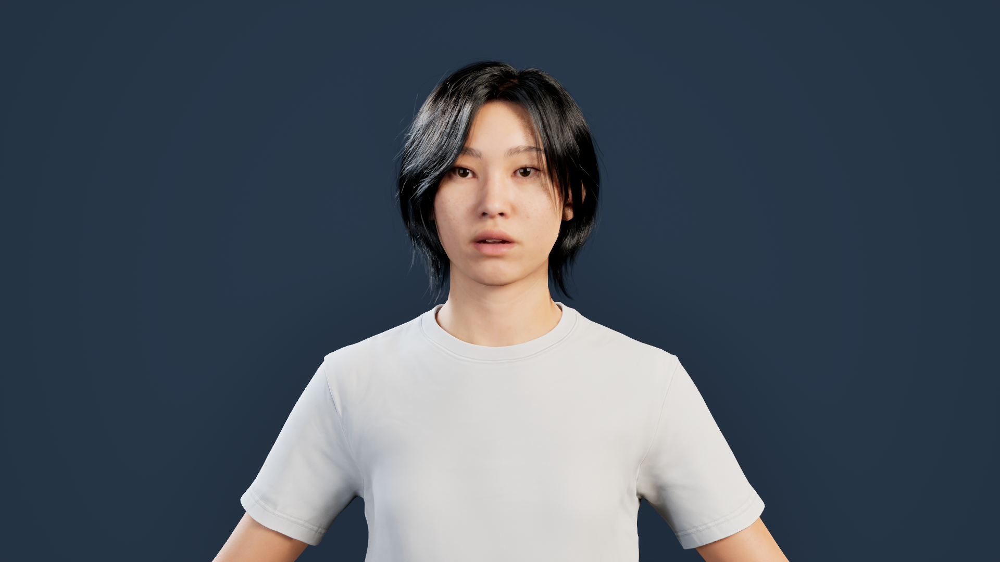
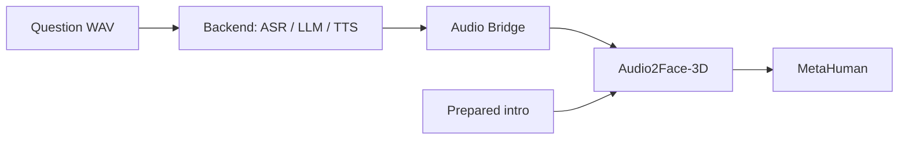

# Conversational AI Avatar

**A speech-driven MetaHuman powered by NVIDIA ACE and Unreal Engine.**

Meet **Kagawa**, a virtual assistant that answers spoken questions with a synthesized voice and synchronized facial animation. A Python backend handles speech recognition, language generation, and speech synthesis; an audio bridge delivers the response to Unreal Engine for playback through NVIDIA ACE Audio2Face-3D.

## What the demo does

- Plays a prepared introduction when the Unreal scene starts.
- Accepts a recorded question and generates a new answer through ASR, LLM, and TTS.
- Animates the MetaHuman with the local **LocalA2F-Mark** provider.
- Supports successive questions, with the operator waiting for each answer to finish.

The current demo uses **prerecorded WAV input and buffered response playback**. Live microphone interaction is a future-work goal; a microphone client is available for experimentation.

## System overview

The question client publishes to `metahuman-demo`, and Unreal observes that channel. The bridge buffers the complete generated response before passing a WAV to Audio2Face-3D. The startup introduction uses an existing audio clip; answers to submitted questions are generated dynamically.

## Demo configuration

| Component | Configuration used in the local demo |
|---|---|
| Application | Unreal Engine 5.6.1 on Windows, with MetaHuman |
| Backend | Python 3.11, FastAPI, Uvicorn |
| ASR | NVIDIA-hosted Riva speech recognition |
| LLM | NVIDIA-hosted **GPT-OSS 20B**, selected on October 17, 2026 |
| TTS | NVIDIA-hosted **Magpie Multilingual**, English Aria voice |
| Facial animation | NVIDIA ACE Audio2Face-3D, **LocalA2F-Mark** on the Unreal host |

The hosted speech and language services require network access. Unreal character assets, presentation maps, NVIDIA plugins, and model files are installed separately.

**Source status:** the local GPT-OSS demo includes adapter changes that are not yet in this repository. The checked-in backend still has its earlier Nemotron default and request format. See [model configuration and source status](services/orchestrator/README.md#model-configuration-and-source-status) before reproducing the demo.

## Getting started

1. [Set up the Python backend](services/orchestrator/README.md).
2. [Connect an ACE-enabled MetaHuman project](unreal/README.md).
3. [Run the demo](docs/DEMO_GUIDE.md): start the backend, connect Unreal, submit a question, and wait for playback completion.

For an already configured machine, go directly to the [demo guide](docs/DEMO_GUIDE.md). If a response stalls or the face stops moving, use the [troubleshooting guide](docs/troubleshooting/README.md).

## Repository guide

| Path | Contents |
|---|---|
| [`services/orchestrator`](services/orchestrator/README.md) | Conversation backend, WAV/microphone clients, configuration, and tests |
| [`unreal/Plugins`](unreal/Plugins) | WebSocket bridge and buffered MetaHuman receiver |
| [`unreal/tools`](unreal/tools) | Project setup and diagnostic helpers |
| [`docs`](docs/README.md) | Demo instructions, audio flow, validation, and troubleshooting |
| [`infra`](infra) | Optional service deployment templates and endpoint checks |
| [`unreal/ACEAvatarSandbox`](unreal/ACEAvatarSandbox) | Earlier integration scaffold |

## Current limitations

- Each question is independent; the LLM does not retain conversation history.
- Unreal waits for the full TTS response, and overlapping responses are discarded.
- The complete live microphone-to-avatar workflow and a clean-machine setup are not yet validated.

See [validation and known limits](docs/VALIDATION.md) for the scope of the recorded tests.

## Future work

1. **Real-time interaction:** replace prerecorded questions with live microphone input.
2. **Natural avatar animation:** improve facial expressions, eye movement, and idle motion.

## Acknowledgements

Special thanks to [kosuketut/ace_kagawa](https://github.com/kosuketut/ace_kagawa) for its ACE conversation sandbox and reference implementation, including the Python orchestrator and Unreal integration components.

This independent project integrates NVIDIA ACE/Audio2Face-3D and Epic Games Unreal Engine/MetaHuman. Their software, models, and character assets remain subject to their respective terms and are not bundled here.
