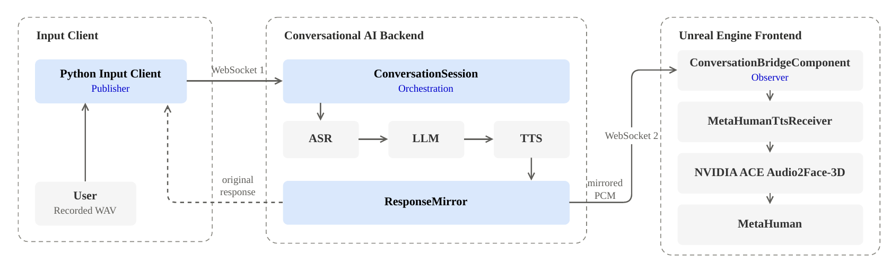

# Conversational AI Avatar

A recorded question goes through speech recognition (ASR), a language model (LLM), and text-to-speech (TTS). Unreal Engine plays the answer through a MetaHuman with synchronized facial animation from NVIDIA ACE Audio2Face-3D.

## System architecture

[](docs/assets/system.pdf)

The Python client sends a WAV question over WebSocket. `ResponseMirror` forwards the synthesized speech and control events to an Unreal observer on the same channel. `MetaHumanTtsReceiver` buffers the full answer before sending it to Audio2Face-3D for playback.

## Build from scratch

1. Clone this repository.

   ```bash
   git clone https://github.com/Yufei1230/conversational-ai-avatar.git
   cd conversational-ai-avatar
   ```

2. [Install and configure the Python backend](services/orchestrator/README.md).
3. [Create an ACE-enabled MetaHuman project and install the Unreal plugins](unreal/README.md).
4. [Send a recorded question and verify avatar playback](docs/RUN.md).

The reference setup uses Windows, Unreal Engine 5.6.1, NVIDIA ACE 2.5 with `LocalA2F-Mark`, and hosted speech and language services. Install Unreal, the MetaHuman assets, and NVIDIA's plugins and model separately.

## Repository guide

| Path | Contents |
|---|---|
| [`services/orchestrator/`](services/orchestrator) | FastAPI backend, WAV input client, and tests |
| [`unreal/`](unreal) | WebSocket bridge and MetaHuman receiver plugins |
| [`docs/`](docs) | Run guide, audio flow, and troubleshooting |
| [`infra/`](infra) | Optional local-service templates and endpoint checks |
| [`future-work/microphone/`](future-work/microphone) | Experimental live microphone input for Python and Unreal |

Each WAV submission starts a new turn without conversation history. The avatar plays one complete answer at a time. Physical microphone-to-MetaHuman operation and a fresh-machine Unreal build still need end-to-end validation.

## Acknowledgements

The [`ace_kagawa` reference implementation](https://github.com/kosuketut/ace_kagawa) provided the basis for the Python orchestrator and Unreal WebSocket bridge. This project adds response mirroring and buffered delivery to the MetaHuman.
