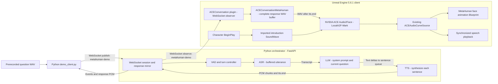

# NVIDIA ACE + MetaHuman Conversational AI Avatar

A speech-driven digital human demonstration built with **Unreal Engine 5.6.1**, MetaHuman, NVIDIA ACE Audio2Face, and a Python conversation backend. A prerecorded spoken question is transcribed, answered by an LLM, synthesized into speech, and presented by a MetaHuman through the local `LocalA2F-Mark` provider.

The project explores how speech, language, and character-animation systems can work together in a repeatable demonstration. Its main engineering contributions are a WebSocket conversation bridge, response fan-out to Unreal, a buffered MetaHuman audio adapter, and a separate studio presentation that preserves the working conversation setup.


*Actual game-viewport capture from the local `/Game/MetaHumanPresentation_Reviewed` level. Character assets, presentation maps, NVIDIA model files, and Unreal Engine are not distributed in this source repository.*

**Start here:** [Demo guide](docs/DEMO_GUIDE.md) ? [Audio and conversation flow](docs/AUDIO_AND_CONVERSATION.md) ? [Validation and limitations](docs/VALIDATION.md) ? [Unreal integration](unreal/README.md)

## Implemented features

- Prerecorded WAV input through a Python CLI; real ASR ? LLM ? TTS responses have been exercised in the local Unreal demo.
- A FastAPI WebSocket backend with VAD/explicit end-of-input handling, streamed LLM text, sentence-based TTS requests, and binary PCM audio frames.
- Publish/observe routing: a question client publishes to `metahuman-demo`; the Unreal observer receives the resulting response without capturing a microphone itself.
- An `ACEConversationMetaHuman` adapter that buffers a complete response, creates a temporary WAV, and submits it to the existing NVIDIA ACE character setup.
- Synchronized speech and facial curves through the existing `ACEAudioCurveSource` and MetaHuman face animation graph.
- Repeated, operator-paced questions while the Unreal observer stays connected. **Each shipped CLI invocation creates a new session; the LLM has no conversation memory.**
- A separate upper-body studio presentation with a blue-gray background, intended camera, and locally validated 1920?1080 capture profile.
- Protocol/session tests, synthetic observer-routing and PCM conversion tests, and an Unreal buffered-WAV automation test.

An additional [live microphone client](services/orchestrator/tools/LIVE_MIC_CLIENT.md) exists. Its conversion and routing paths have synthetic coverage; those tests do not validate a physical Mac microphone session. Prerecorded WAV input is the documented demonstration path.

## Architecture



ASR, LLM, and TTS use configured service adapters; the validated English setup uses NVIDIA-hosted services. `LocalA2F-Mark` runs on the Unreal host. A local facial-animation provider does **not** make the entire conversation pipeline offline.

### Two distinct audio paths

**Startup introduction:** pressing Play runs the existing character BeginPlay logic. It submits the imported `/Game/TestAudio/english-e2e` SoundWave to ACE. That clip originated from an earlier LLM/TTS response, but startup playback makes no new ASR, LLM, or TTS request.

**Dynamic question:** `demo_client.py --wav ...` sends 16 kHz mono PCM16 input over WebSocket. The backend buffers the utterance for ASR, streams LLM text into a sentence queue, and synthesizes each sentence. Unreal receives PCM chunks but waits for the **entire TTS response** before submitting a WAV to Audio2Face. The existing ACE component then drives speech and facial animation together.

This is buffered playback with chunked network transport, not incremental token-to-mouth animation. Backend `turn_complete` means generation and transmission finished; Unreal's separate playback-completion message determines when to submit the next question. See [the detailed flow](docs/AUDIO_AND_CONVERSATION.md).

## Technology and inspected environment

| Component | Role / inspected version |
|---|---|
| Unreal Engine **5.6.1** | Windows renderer and application host; installed build CL 44394996 |
| MetaHuman | Existing character, face rig, hair, and face animation Blueprint |
| NVIDIA ACE plugin | Installed `NV_ACE_Reference` version `2.5.0-20250614-2282` |
| `LocalA2F-Mark` | Installed local Audio2Face provider |
| Python / FastAPI / Uvicorn | Conversation state and WebSocket endpoint; Python 3.11 environment used locally |
| ASR / LLM / TTS | NVIDIA Riva gRPC recognition, an OpenAI-compatible chat API, and hosted speech synthesis in the demonstrated configuration |
| WebSocket / ACE1 | JSON control messages and framed little-endian PCM16 audio |

The Python package declares Python ?3.10. The MetaHuman receiver currently declares **Win64** support. Models, endpoints, credentials, and voice selection are configured through an ignored `.env`; templates record a configuration, not a guarantee of current service availability.

## Setup and execution

For the already configured Windows machine, follow the [demo guide](docs/DEMO_GUIDE.md). It preserves the existing environment, audio files, maps, and animation Blueprints.

For a new checkout, these are **setup instructions, not a newly validated clean-machine installation**:

```powershell
# From the repository root; requires an installed Python 3.11 interpreter.
Set-Location services/orchestrator
py -3.11 -m venv .venv
.\.venv\Scripts\python.exe -m pip install -e .
if (-not (Test-Path -LiteralPath .env)) {
    Copy-Item -LiteralPath .env.example -Destination .env
}
```

Configure service access and credentials in `.env` using the [backend guide](services/orchestrator/README.md). Keep all three mock flags false for a real demonstration. Do not replace a working environment with the template.

```powershell
# From services/orchestrator, after configuring the environment.
.\.venv\Scripts\python.exe tools/init_storage.py
.\.venv\Scripts\python.exe -m uvicorn app.main:app --host 127.0.0.1 --port 8080 --workers 1
```

Use **one worker**: response routing is stored in process memory. A new machine also needs Unreal Engine, an assembled MetaHuman with a working ACE facial graph, and compatible NVIDIA ACE/Mark plugins and model assets. Follow [Unreal integration](unreal/README.md); cloning this repository alone does not supply the local `MetaHumanTest` project or maps.

Once Unreal reports its observer ready, submit a prepared WAV in a second terminal:

```powershell
# From services/orchestrator. Replace the input path with your recording.
$question = Join-Path $env:USERPROFILE 'Documents\VoiceQuestions\question1.wav'
$answer = Join-Path 'outputs' ('answer-' + [guid]::NewGuid().ToString('N') + '.wav')
.\.venv\Scripts\python.exe tools/demo_client.py `
    --url 'ws://127.0.0.1:8080/ws/session?publish=metahuman-demo' `
    --wav $question --require-real --output $answer
```

This custom-path example uses the existing CLI interface; it was not executed with a new personal recording during the documentation review. The guide includes the previously exercised demo-file command, readiness logs, and required manual wait between questions.

## Repository map

| Path | Purpose |
|---|---|
| [`services/orchestrator`](services/orchestrator/README.md) | Backend, CLI clients, configuration template, Python tests |
| [`unreal/Plugins/ACEConversation`](unreal/Plugins/ACEConversation) | WebSocket bridge and generic microphone/audio diagnostics |
| [`unreal/Plugins/ACEConversationMetaHuman`](unreal/Plugins/ACEConversationMetaHuman) | Buffered adapter reusing the existing NVIDIA ACE character |
| [`unreal/tools`](unreal/tools) | Local preservation, setup, validation, and audio-diagnostic helpers |
| [`docs`](docs/README.md) | Demo workflow, implementation explanation, validation, and related research |
| `unreal/ACEAvatarSandbox` | Generic integration scaffold; not the finished MetaHuman project |
| `infra/`, `tts/`, `Irodori-TTS` | Separate Tokkio/Linux, RAG, and Japanese TTS experiments; not required by the Windows demo |

## Validation

On **2026-10-10**, all **30 Python unittest tests passed**, and `pip check` reported no broken requirements in the existing environment. A saved Unreal report records `ACE.MetaHuman.BufferedWav` passing on 2026-09-28. Earlier real-provider runs reached MetaHuman playback completion; the presentation review separately checked the camera, startup audio/animation, and a native 1080p viewport.

These are different kinds of evidence. Unit tests do not establish perceptual lip-sync quality, and a startup-clip rendering check does not establish a new ASR ? LLM ? TTS turn. See [validation scope and evidence](docs/VALIDATION.md) before interpreting results as benchmarks.

## Current limitations and next steps

- **No conversation memory:** each LLM request contains only the system prompt and current transcript. A channel name is a routing label.
- **Manual turn pacing:** one WAV per CLI invocation; no native playlist, backend playback acknowledgement, or automatic question queue. Overlapping Unreal responses are rejected.
- **Buffered latency:** ASR waits for the utterance; Unreal waits for the complete response. No end-to-end latency benchmark is claimed.
- **Half-duplex demonstration:** no validated barge-in workflow. The WAV client does not play the user's question aloud.
- **Limited idle behavior:** independent blinking, gaze shifts, and head/body idle were not active in the inspected presentation; the face can retain its final ACE pose.
- **Local-demo deployment:** no WebSocket authentication or application TLS, no cross-worker routing, no automatic Unreal reconnect, and no packaged-release validation.
- **External prerequisites:** provider access, compatible GPU/runtime, proprietary character/engine assets, and local maps are required. Existing diagnostic warnings remain in logs even when capture overlays are hidden.

Planned improvements are explicit conversation history, a playback-finished acknowledgement and turn queue, safely blended idle/gaze animation, lower-latency audio delivery, and broader deployment/capture testing. These are development directions, not implemented features.

## Project scope and attribution

This is an independent integration and demonstration project, not an official NVIDIA or Epic Games sample. NVIDIA ACE/Audio2Face and Epic Games Unreal Engine/MetaHuman are external dependencies. Their SDKs, models, character assets, and applicable terms remain separate from this repository. No third-party binaries or new license grant are included in this documentation update.
